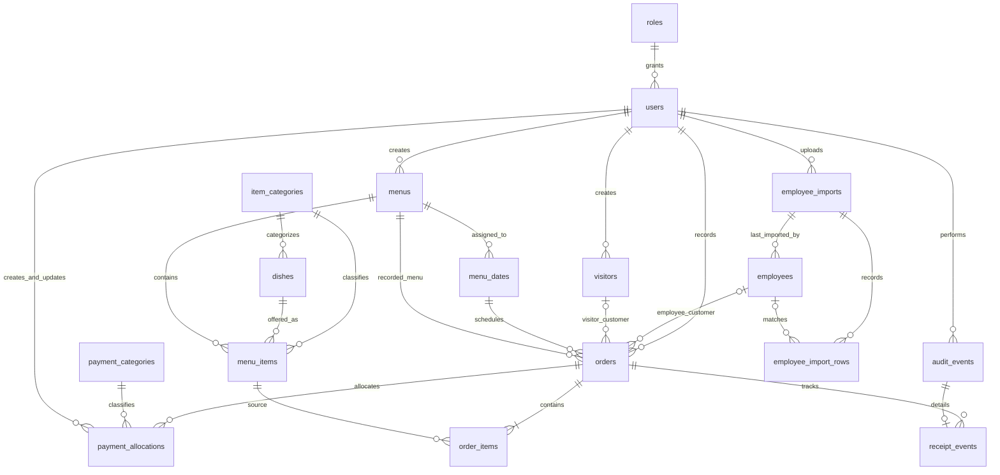

# ASI Meal Management — Database design proposal

## 1. Design overview and current foundation

**Confirmed sources:** [Business requirements](business-requirements.md),
[Workflow discovery](business-workflow-discovery.md), root `AGENTS.md`, and
`README.md`. The two business documents include existing uncommitted changes;
this proposal preserves them. `docs/adr/` contains no decisions to apply.

**Latest owner decisions take precedence:** This revision supersedes the older
business documents where they count sales at order recording, leave split methods
unresolved, discuss site-access design, or permit Assistant Admin Received reversals.
The adopted Version 1 decisions are Return to Pending first for corrections,
retained configured menu categories, and Admin-only Received reversals. These
supersede the earlier open alternatives; the linked documents remain unchanged.
Version 1 is one unified directory, catalog, order and reporting system,
with no site subsystem, mandatory site assignment, partitions, or site-based
reporting/access restrictions. Future authorized staff use their own accounts.

The inspected API contains a FastAPI app with `/health` and one health test.
SQLAlchemy, Alembic, and psycopg are listed dependencies, but no database models,
session configuration, migrations, or persistence functionality were found.
Authentication is not implemented. No database was contacted for this proposal.

**Confirmed:** PostgreSQL in the local/on-premises modular monolith; HRMS CSV is
the employee integration. Received means internally paid with staff accountability,
not verified GCash or completed payroll. Orders can be recorded before Received;
pending orders are visible separately. Only currently Received orders contribute
to recognized sales, including SD orders, without waiting for payroll. No separate
Paid/Unpaid status, external financial processing, inventory, or AI is included.

**Proposed:** The following tables, types, constraints, transactions, and indexes
are technical choices for review, not implemented schema or approved new policies.
**Unresolved** identifies business decisions still needed. Retain confirmed
behavior even where a proposed default is rejected.
**Adopted Version 1 default** identifies an owner-selected decision to carry into
the final proposal. The proposal as a whole still requires explicit owner approval
before implementation; these selections do not authorize implementation.

## 2. Proposed tables and important columns

Unless stated otherwise, `id` means a `bigint` identity primary key. Foreign-key
columns have their target's type. Required fields are non-null; fields marked
optional are nullable. Money uses `numeric(12,2)`, quantities use `integer`, dates
use `date`, and action times use `timestamptz`. This is a Philippine-peso-only
proposal; no exchange-rate or multi-currency functionality is needed.

| Table | Purpose and important columns |
| --- | --- |
| `roles` | `code text PK`, `display_name text`; permitted codes `admin`, `assistant_admin`. |
| `users` | `id`, `login_name text UNIQUE`, `display_name text`, `password_hash text`, `role_code FK roles`, `is_enabled boolean`, `created_at`, `updated_at`. Individual accounts only; display name supports the correction confirmation, not identity proof. Disabling login does not affect employee eligibility. |
| `employees` | `employee_number text PK`, `full_name text`, optional `position`, `campaign`, `line_of_business` as text; `last_import_id FK employee_imports`, `created_at`, `updated_at`. Employee number is the identity, never name/phone. The blank CSV assigned-site field is not needed for Version 1 and is not proposed for storage or access control. |
| `visitors` | `id`, `display_name text`, `created_by FK users`, `created_at`, `updated_at`. Stable internal identity independent of name; precise additional fields unresolved. |
| `item_categories` | `code text PK`, `display_name text`, `default_unit_price numeric(12,2)`. Proposed codes: `vegetable`, `non_vegetable`, `extra_rice`. Owner's working prices: ₱50 and ₱75 including rice, and ₱15 extra rice. Prices are configurable data. |
| `dishes` | `id`, `name text`, `category_code FK item_categories`, `is_active boolean`, `created_at`, `updated_at`. Extra rice can be a catalog item without introducing inventory. |
| `menus` | `id`, optional `label text`, `created_by FK users`, `created_at`, `updated_at`. Reusable menu definition. |
| `menu_dates` | `service_date date PK`, `menu_id FK menus`. One reusable menu can serve many dates; one shared menu per date is the proposed simple scheduling model. No site key or ownership. |
| `menu_items` | `id`, `menu_id FK menus`, `dish_id FK dishes`, `item_name text`, `category_code FK item_categories`, `unit_price numeric(12,2)`. Adopted configured category retained after catalog reclassification; initialize from the selected dish, with price initially drawn from category defaults. Existing category/price changes require explicit action; no unrestricted override. See category consistency below. |
| `payment_categories` | `code text PK`, `display_name text`; permitted codes `cash`, `gcash`, `sd`, `incentive`, `finance`. No For Deposit entry. |
| `orders` | `id`, `request_key uuid UNIQUE`, `service_date FK menu_dates`, `menu_id FK menus` recording the menu selected for that date at creation; `recorded_at`, `created_by FK users`, optional `employee_number FK employees` or `visitor_id FK visitors`; customer name and relevant report-organization snapshots; `is_received boolean DEFAULT false`, optional `receipt_changed_by FK users`, `receipt_changed_at`; `version integer`. Category is recorded through allocations, not a single order-level category field. |
| `order_items` | `id`, `order_id FK orders`, `line_number integer`, `source_menu_item_id FK menu_items`, `item_name text`, `category_code_snapshot text`, `unit_price numeric(12,2)`, `quantity integer`, `line_total numeric(12,2)` calculated from price × quantity. All item detail fields are sale-time snapshots. |
| `payment_allocations` | `id`, `order_id FK orders`, `payment_category_code FK payment_categories`, `amount numeric(12,2)`, `created_by FK users`, `created_at`, `updated_by FK users`, `updated_at`. One row for a single method or several rows for a split; changes retain allocation IDs and before/after audit history. These are recorded allocations, not externally verified payments. |
| `audit_events` | `id`, `actor_user_id FK users`, `occurred_at`, `action text`, `entity_type text`, `entity_key text`, optional `before_values jsonb`, `after_values jsonb`, `reason text`. Restricted business audit history; never passwords, tokens, raw CSV, or unnecessary contact details. |
| `receipt_events` | `audit_event_id PK/FK audit_events`, `order_id FK orders`, `from_received boolean`, `to_received boolean`; correction `reason_code text`, `reason_label_snapshot text`, optional `reason_explanation text`. Reason code/label are required for corrections; an initial mark is distinguished by its action and need not invent a correction reason. Actor, action, and timestamp come from the linked audit event. |
| `employee_imports` | `id`, `uploaded_by FK users`, `started_at`, optional `completed_at`, `source_sha256 text`, `encoding text`, `delimiter text`, `status text`; `total_rows`, `inserted_rows`, `updated_rows`, `unchanged_rows`, `rejected_rows` as integers; optional `file_error_code text`. No uploaded file contents required in this table. |
| `employee_import_rows` | `id`, `import_id FK employee_imports`, `row_number integer`, `outcome text`, optional `employee_number FK employees` for matched/accepted records; `issues jsonb` containing approved field names and error codes, not raw personal values. |

**Proposed authentication default:** If local passwords are approved, store only
modern salted password hashes (for example Argon2id), never plaintext or reversible
passwords. Do not create default/shared accounts or embed credentials. Session,
password reset, and first-Admin provisioning details need a separate security
review before authentication implementation.

## 3. Keys, constraints, and validation

- **Proposed:** Enforce all listed foreign keys; default to `RESTRICT` for deletion
  of referenced employees, visitors, users, dishes, menus, orders, and audit records.
  No cascade should erase financial or correction history. No employee eligibility
  flag or automatic removal based on a later CSV is proposed.
- **Proposed:** Unique `(menu_id, dish_id)` in `menu_items`, `(order_id, line_number)`
  in `order_items`, and `(import_id, row_number)` in import results. Do not make
  employee names, visitor names, or employee/date order pairs unique: multiple
  orders are not prohibited. Confirm dish duplicate matching before imposing a
  name-based constraint.
- **Proposed:** Unique `(order_id, payment_category_code)` consolidates each
  method's allocated amount once per order; multiple methods remain allowed.
  Check allocation amounts are positive, finite, and within money precision.
- **Proposed:** Trim/validate nonblank identifiers, names, and codes. Preserve
  employee-number text, including any leading zeros; do not impose a fixed length
  or case-normalization policy without confirmation. Case-insensitive uniqueness
  for login names is proposed, not for employee/visitor names.
- **Proposed:** Check quantity and line number > 0, unit/default prices >= 0,
  version > 0, and finite monetary values (reject PostgreSQL numeric `NaN`).
  Require exactly one of employee number and visitor ID on each order. For a
  visitor order, require every allocation to use Finance. Do not infer that Finance is
  exclusively for visitors in the reverse direction.
- **Proposed:** Category code constraints admit only the approved categories.
  Generate stored `line_total` from `quantity * unit_price`; reject values outside
  the declared money precision. Derive the order total by summing its lines rather
  than independently storing a second mutable total.
- **Proposed:** Restrict import status to processing/completed/failed and row
  outcome to inserted/updated/unchanged/rejected; counts and row numbers cannot
  be negative (row numbers start at one). At completion, validate result counts
  against row outcomes in the transaction; file-level failures may have no rows.
- **Proposed:** Receipt changed-by/time must be both present or both absent;
  Received=true requires both. A reversal retains the latest correction actor/time,
  while original actors/times remain in receipt history. Receipt transitions must
  change the value. No `paid_at`, unpaid balance, payroll-confirmed, or transfer-
  verified field is proposed.
- **Proposed:** Enforce nonempty orders, valid source-menu/date membership,
  visitor-Finance allocation rules, completed allocation equality, valid audit-to-
  receipt-event linkage, and atomic audit writes in the backend transaction;
  ordinary row checks cannot enforce cross-table rules. Deferred database
  constraint triggers can enforce nonempty orders and allocation invariants at
  commit if needed. These are data-integrity checks, not external verification.

### Split allocation entry and consistency

**Confirmed:** A regular order uses one allocation; Split Payment reveals multiple
method/amount inputs. Show allocated total and difference from the order total.
Completed allocations must sum to the order's snapshot line totals. Example:
1 vegetable meal + 2 non-vegetable meals + 3 extra rice = **₱245**, allocated as
**GCash ₱200 + Cash ₱45**. This checks entered arithmetic only, not cash receipt,
GCash settlement, payroll, signatures, or photos.

**Proposed timing default:** Allow pending order entry before allocation is complete;
require at least one allocation and exact equality when marking Received. If
an order is Received, reject item/allocation edits until an Admin reverses it
through the audited correction workflow. Pending edits follow approved field
permissions and validation; consistency must hold before marking Received again.
Lock the parent order for every item/allocation/receipt edit so concurrent changes
cannot bypass this invariant. Confirm this save-time policy before implementation.
An incomplete pending allocation is an entry difference, not a receivable balance;
no partial-payment tracking, separate approval, or payment-verification state is added.

### Menu/date/order integrity

**Required integrity:** A new order's date must have an assigned menu and every
selected offering must belong to that menu. Independent foreign keys establish
existence, but do not establish this relationship across the tables.

**Proposed transaction approach:** On the server, begin the order-creation
transaction, lock the existing `menu_dates` row against reassignment/deletion,
and read its assigned menu. Reject a date with no assignment. Lock the menu and
selected offering rows against edits/moves/deletion, then verify that every
offering's `menu_id` equals that assignment. Resolve names, categories, and prices
from these locked server-side records, not browser claims. Store the selected
menu ID on the order, insert all snapshot lines/allocations and the audit event,
and commit together. Reject invalid combinations without saving a partial order.
Hold these locks through commit, not merely during an earlier UI lookup.

**Proposed writer discipline:** Menu/date reassignment and menu/offering edits
must acquire conflicting locks on the same affected rows/parent menu. Acquire
date, menu, and offering locks in a consistent order and retry/reject stale
requests rather than allow a race between validation and creation. A source
offering must not be moved between menus once referenced; copy it instead.
This rule needs backend enforcement (or a narrow database trigger), since its
single-column foreign key would not prevent a move.

**Practical constraints:** Keep the existing date/menu/offering foreign keys and
date uniqueness, and add the proposed order-to-menu foreign key. Use backend
membership validation and transactional locking rather than duplicating the
whole date/menu chain in composite keys. A cross-table CHECK cannot enforce it.
If defense against direct database writes becomes necessary, a focused constraint
trigger may additionally validate membership; it must use the same concurrency
discipline. No SQL or database objects are created by this proposal.

Later menu edits/reassignment do not rewrite recorded order-menu links or item
snapshots. `orders.menu_id` is the menu validated at recording, not a live promise
that the date's assignment can never change. Ordinary pending edits retain valid
source links to that recorded menu; permission to change an order's date/menu or
replace its source items remains open and must revalidate the whole relationship
transactionally if approved. Do not recalculate existing snapshots from current
catalog/menu values merely because an order is marked Received again.

## 4. Relationships and ER diagram

Employees and visitors are separate order-customer alternatives. Users are staff
accounts, not employee identities. Menus contain offerings and can be assigned to
several dates; each order has several snapshot lines and zero or more allocations
while pending (one or more when Received under the proposed validation timing).
Each allocation has one payment category. Every receipt transition
links to one audit event. General audit targets use type/key because they span
several tables; these target keys are not automatic foreign keys.

The employee/visitor alternatives require the XOR check above; the diagram alone
does not enforce it. Additional actor foreign keys are described in the table list.
The date-to-menu and order-to-menu edges do not enforce offering membership or
equality with the date assignment at creation; the transaction above does.
Dish/menu category edges validate allowed categories independently and deliberately
permit retained offering categories after catalog reclassification.

## 5. Historical sale details and configurable prices

**Confirmed:** Preserve dish name, category, unit price, quantity, and line total
on recorded sales. **Proposed:** Copy menu details into order items in the order-
creation transaction and calculate line totals from those copied values. Reports
must read these snapshots, never recalculate from current menu/catalog prices.
Store customer display/organizational snapshots needed by approved reports so
later HRMS or visitor-name edits do not relabel historical reports unexpectedly.
The employee number/visitor ID remains the stable relational link.

Category default price changes affect new menu configuration only; configured
menu offerings retain their price until an authorized edit. Future menu edits
cannot update recorded sale snapshots. Corrections to recorded items/prices must
be explicit and audited while Pending under the adopted procedure below; exact
permitted correction fields and role permissions remain **Unresolved**.
Read source prices consistently within the transaction to avoid mixed revisions.

### Controlled editing of Received orders

**Confirmed:** Item or allocation changes must not silently change recognized
sales. Only current Received orders count, consistency rules still apply, and all
changes retain the original audit history. This includes allocation-only edits
that change category/SD totals even when the overall order total is unchanged.

**Adopted Version 1 default — Return to Pending first:** Reject item or allocation
edits while Received, including generic edit requests. An Admin must first reverse
Received using the confirmed reason/Other-explanation/confirmation workflow.
The atomic audited reversal immediately removes the order and its allocations
from current recognized sales, category totals, and SD reports, without deleting
the order or its history. Correct approved fields while Pending; mark the corrected
order Received again after validation to restore its current contribution once.
Direct correction while keeping Received is not a Version 1 procedure.

**Proposed technical safeguards:** Resolve the actor from the server session,
check the permitted action/fields, lock the order, check its version and current
Pending status, and show before/after details and totals. Validate quantities,
prices, source-menu links, visitor-Finance allocations, and applicable consistency
rules. Save each important edit and its audit event atomically, retaining affected
line/allocation identifiers, before/after values and totals. Reject stale writes,
including edits racing with a Received mark. Status transitions retain separate
receipt events; detail edits must not invent a status transition.

**Pending edit boundary:** Routine item/quantity and allocation entry is supported
under approved permissions. Pending is not blanket authority to change every
field. **Unresolved:** The field-by-role matrix for correcting an existing order,
including item replacement, quantity/price/category changes, allocation changes,
customer identity, and service date/menu changes. Sensitive or undefined field
changes must not be enabled by assumption. Also confirm whether detail edits
reuse the existing reason/checkbox controls; status reversals already require
them. No refunds, cancellations, extra approval steps, external verification, or
additional payment statuses are introduced.

## 6. Menu reuse and popularity

**Proposed:** Assign one menu ID to several `menu_dates`. Assign another menu on
dates where meals change. When editing only some future dates of a reused menu,
copy the menu and its items and reassign those dates; do not accidentally change
all dates using the original. All menu changes are audited; existing orders remain
protected by snapshots regardless of source edits.

**Confirmed direction:** Rank by menu selections, not sales. **Proposed default:**
Count distinct menu definitions containing a dish, within its category; merely
assigning that same menu to more dates does not increase the count. Break ties by
name then ID. Derive counts from `menu_items`, avoiding a mutable popularity
counter. This definition, treatment of edits/deletions, and ties need approval.

### Dish and menu-offering category consistency

**Adopted Version 1 default — Retain configured menu categories:** When adding a
dish to a menu, initialize its offering category from the current catalog category.
Existing offerings retain that configured category after catalog reclassification.
No automatic cascading category or price updates and no unrestricted overrides.

**Proposed enforcement:** The backend reads the selected dish's current
`dishes.category_code` and copies it to `menu_items.category_code` on creation,
initializing the new offering price from that category's default. Explicit
reclassification validates the category but uses the price confirmation below,
not automatic price initialization. Validate category membership against
the selected dish at creation or explicit reclassification in the same transaction;
do not trust an unrelated category supplied by the browser. Coordinate catalog
reclassification and offering writes with locking so a concurrent change cannot
produce an accidental mismatch.

Both category columns reference `item_categories`, which validates allowed codes
but does not enforce equality between the two records. Under this snapshot
interpretation, a later authorized catalog reclassification is audited and does
not cascade into existing menu offerings. A retained older offering category is
intentional configuration history, not permission for arbitrary overrides.
Present such differences when staff review/reuse a menu. Updating an offering's
category requires an explicit authorized, audited action matching the selected
dish's current category. Simply retaining an existing intentional configuration
difference requires no forced synchronization. Unrelated edits must not use that
exception to submit an arbitrary new category.

**Price confirmation:** When explicitly changing an offering's category, show its
current configured price and the new category's default. Require an explicit
choice to retain the current price or enter/select the applicable permitted price
before saving; never silently reset it. Audit the chosen category and price with
before/after values, even when the price is retained. Price-override permissions
and limits remain open; this confirmation is not authorization for arbitrary prices.
Existing `order_items` category/name/price snapshots never change from these
catalog/menu operations: they describe the sale as recorded, and reports use them.

**Constraint choice:** Keep independent foreign keys to `item_categories` and
backend validation for creation/explicit reclassification. Do not add a composite
foreign key forcing offering and catalog categories always to match; it would
contradict retained configurations. The retained difference is a documented
snapshot, not an unrestricted override. **Unresolved:** Exact role permissions
for reclassification and price overrides. No catalog/menu operation may rewrite
historical order snapshots.

## 7. Receipt corrections, audit, and permissions

**Confirmed:** Both Admin and Assistant Admin record/manage orders, menus/catalog,
and visitors, select categories, mark Received, and view reports. Admin
also manages user accounts/roles and views audit logs. Assistant Admin cannot
manage accounts/roles or have unrestricted security-settings access. Employee
import permission and Assistant Admin audit access remain unresolved. No site-
based restrictions are proposed; individual accounts and roles govern access.

**Adopted Version 1 default — Admin-only Received reversals:** Admin may reverse
Received subject to the correction safeguards. Assistant Admin may perform
approved routine operations and mark Received, but cannot reverse it initially.
Enforce this on every backend reversal request, not just through UI visibility.
The restriction may be reconsidered after actual workflow review; that review is
not an unresolved permission blocking this initial default.

**Demo alignment:** One individually authenticated Admin can demonstrate the same
reversal workflow. Demo and initial production role rules agree on Admin-only
reversals; this does not approve the entire production security design or create
any account, shared credential, or authentication functionality.

**Proposed:** One role per individual user is sufficient initially; avoid an extra
permission-management subsystem. Enforce the documented matrix on every backend
use case, not just the UI. Missing/unapproved sensitive permission is denied until
defined. An ordinary application user must not have direct database access; use
restricted database privileges rather than making application users DB superusers.

### Correction reasons and confirmation

**Confirmed:** Corrections offer a configurable predefined reason list, initially:

- Mistaken click
- Incorrect employee marked
- Incorrect order marked
- Incorrect order details
- Other reason

Selecting Other reason requires a non-empty explanation; whitespace-only text is
not sufficient. The list can be refined from user feedback after the demo.
Selecting Incorrect order details records why the status was corrected; it does
not authorize an otherwise undefined item-edit, refund, or adjustment workflow.

**Proposed demo configuration:** Use one small predefined server-side list shared
with the correction form, not a settings interface or reason-management subsystem.
The following stable codes are recommended; the five labels above remain confirmed.

| Proposed stable code | Initial display label |
| --- | --- |
| `mistaken_click` | Mistaken click |
| `incorrect_employee_marked` | Incorrect employee marked |
| `incorrect_order_marked` | Incorrect order marked |
| `incorrect_order_details` | Incorrect order details |
| `other` | Other reason |

Use code `other`, not the editable label, to require a trimmed non-empty explanation.
Future configuration changes may rename or retire selectable options after demo
feedback; never reuse a code for a different meaning or rewrite old events. Keep
each correction's original code, label snapshot, and explanation. Historical
display reads those saved fields even if that code is no longer selectable.
The backend validates new submissions against the current predefined list;
historical records must not depend on membership in today's list. No new reason
table, configurable management interface, or implementation is needed for the demo
proposal; revisit storage only if a real configuration use case requires it.

**Confirmed:** Before submission, show a confirmation checkbox using the
authenticated user's display name: `I, {authenticated display name}, confirm this change.`
Submission remains disabled until it is selected. This is the same acting user's
acknowledgement, not a second approval or independent payment verification.
Derive actor identity from the authenticated session on the server; never accept
a browser-supplied name or user ID as proof of identity. A display name is only
presentation, not the audit identity.

**Proposed enforcement/storage:** Validate the selected configured reason,
Other explanation, and checked acknowledgement on the server as well as in the
interface. Persist a stable reason code, its label at the time, and any explanation
in the receipt event, so later reason-list edits do not rewrite correction history.
The UI restriction alone is not authorization; recheck actual permission on every
request. Precise configuration storage remains a technical implementation choice.
For receipt corrections, the typed receipt event is the source for code/label/
explanation; any general audit summary must agree. Proposed validation requires
nonblank correction codes/label snapshots and a non-whitespace explanation for
`other`. Do not cascade a future label change into audit data.

**Confirmed atomicity:** Save every status transition and its corresponding audit
event atomically. Each event retains the authenticated actor, timestamp, affected
order, previous/new status, action, and applicable correction reason; preserve the
complete history through reversals and re-marking.

**Proposed transaction mechanics:** Resolve the actor from the server session,
check permission and correction inputs/acknowledgement, then lock the order,
compare its expected version, update Received and latest actor/time, increment
version, and insert both the audit event and typed receipt event. Apply the
approved allocation consistency checks to the same locked order. Commit together
or roll everything back. Record both marking and reversal. Concurrent stale edits
must be rejected for review, not silently overwrite another action. Retried
no-change receipt requests do not create fictional transitions.

**Confirmed:** Received is the authorized staff member's administrative confirmation
that their task is complete, following the manual workflow. It means internally
paid and qualifies the order for recognized sales. There is no separate paid
status, external verification gate, additional approval, or required evidence of
cash handover, GCash settlement, payroll, a signature, or a photograph. Signature/
photo capture would be future enhancements only, not Version 1 requirements.
Reversing Received returns the order to pending and immediately removes it and
its allocations from current recognized-sales/category/SD totals; the order and
all transition history remain. Re-marking includes it once, never accumulates an
extra sale. Other financial correction policies remain unresolved; the correction
reason selection and Other explanation requirements above are now confirmed.

**Proposed:** Audit important order/item/allocation/menu/catalog/visitor writes, employee imports, and
user/role changes in the same transaction as the corresponding data changes.
Allocation additions, edits, and removals retain their identifiers and relevant
before/after details in audit history; current reports use only current allocations.
Audit tables are append-only to the application: no update/delete privileges.
Historical actor foreign keys survive account disabling. Audit payloads use
allowlisted relevant fields; required historical personal data receives restricted
access and must not be copied into general logs. Exclude password hashes as well
as plaintext secrets. General entity references require backend validation.

## 8. HRMS imports and validation results

**Confirmed:** Preserve all successfully imported employees and import history;
HRMS owns employee information. Consume approved CSV exports using employee number
as the stable identifier. Update HRMS-managed fields from subsequent approved
imports under a documented policy; never silently invent local corrections to
campaign or other upstream values. Retain employees absent from a later import
unless an explicit deactivation policy is approved. No invented employment-status,
meal-eligibility, or SD-eligibility rules, HRMS API, or HRMS modifications.

**Proposed:** Validate encoding/delimiter/header structure first, then required
values, row widths, and duplicate employee numbers. Record row outcomes such as
inserted, updated, unchanged, or rejected. Keep issues as field/error codes and
row numbers; do not persist raw rows or contact fields just for diagnostics.
**Proposed simple policy:** Apply validated approved CSV values to the agreed
HRMS-managed fields and audit changes, leaving sale-time customer snapshots
unchanged. Report an upstream data-quality concern for correction at HRMS; do not
add a manual conflict queue for every normal changed field or guess the right
campaign locally. Field mapping, blank-value behavior, and approval of this import
policy remain unresolved. Duplicate/missing employee numbers and malformed rows
are integrity errors, not grounds for inventing eligibility restrictions.

Use a short transaction to create the import job, then apply accepted rows,
row results, counts, completion state, and audit records atomically. If applying
fails, roll back employee changes and record a failed import separately. Fatal
file-validation errors are job-level results; valid-file partial acceptance is a
**proposed default requiring approval**. Hashes identify repeat files for review,
but are not unique: an intentional retry must remain possible. Serialize competing
imports or detect conflicts; unique employee numbers remain the final safeguard.

## 9. Reporting, consistency, and indexes

**Proposed:** Start with queries, not stored summary tables, payroll runs, or
materialized views. Sum order-item line totals per order before other joins, to
avoid multiplying totals through receipt/audit history or allocations. Derive
daily, weekly, monthly, and custom reports from the same current Received population.

**Confirmed:** Orders exist before Received. `is_received=false` means pending,
visible separately and excluded from recognized sales; `true` means currently
Received and included. This is one receipt flag, not a separate payment status.
Recognized sales sum historical item line totals once per Received order. SD
orders follow the same Received rule without payroll processing/verification.
SD amounts are the SD allocations of qualifying orders, not their entire totals
when other methods also contribute. Group by employee number and approved
snapshot fields. Do not infer cancellation/refund rules.

**Proposed aggregation:** First sum lines by order and allocations by order/category
independently, then select qualifying orders. Overall sales sum the per-order item
total once; category reports sum allocation amounts. Never sum full order totals
once for each method, or directly sum across the item × allocation join. Any
internal comparison uses the same Received orders and checks sum of line totals
against sum of allocations. Read these totals from one consistent database snapshot.

**Confirmed:** Receipt corrections dynamically change current report totals without
deleting history. Query current state; do not permanently increment sales counters
on every Received click. Pending operational lists and optional pending subtotals
must be explicitly separated from recognized sales/category/SD results.
Current daily, weekly, monthly, and custom-range reports all follow this current-
valid-status rule. The same inclusion, removal, and restoration rules apply to SD
allocations; payroll processing is not a prerequisite.

**Proposed:** Use `service_date` as the operational report date, and retain
`recorded_at` separately for audit/late-entry analysis. Store timestamps as instants
and display in Asia/Manila. Report-date basis, week boundaries, cutoffs, and late
entry handling require confirmation. Category totals describe internal records,
not independently verified payments. An optional mathematical comparison uses
the same order population/date basis on both sides, including all approved
categories; it proves only internal arithmetic consistency.

| Proposed index | Common use |
| --- | --- |
| `orders(service_date, id)` where `is_received=true` | Date-range recognized sales; separate date/receipt lookup for pending lists if needed. |
| `payment_allocations(order_id, payment_category_code)` unique | Allocation lookup and per-order/category totals; add category/order index if SD/category queries require it. |
| `orders(employee_number, service_date)` for employee orders | Employee history and SD grouping. |
| `orders(visitor_id, service_date)` for visitor orders | Reused visitor history. |
| `order_items(order_id, line_number)` unique | Order detail and totals; also covers the order FK. |
| `menu_dates(menu_id)`; `menu_items(dish_id)` | Reuse lookup and menu-selection counts; unique menu/dish index covers menu lookup. |
| `receipt_events(order_id, audit_event_id)` | Per-order receipt history. |
| `audit_events(entity_type, entity_key, occurred_at)` | Record history; add actor/time index only if staff-review queries need it. |
| `employee_import_rows(import_id, row_number)` unique | Import outcomes and rejected-row review. |

PK/unique indexes need no duplicate indexes. Add remaining FK/query indexes based
on actual use, not every column. No visitor-name unique index; optional search
indexes can be added when needed. Report finalization/submission snapshots and
locks and finalized-period adjustment workflows remain deferred; live queries do not
guarantee reproduction of a previously submitted report after an authorized edit.

## 10. Unresolved decisions and proposed defaults

| Decision | Proposed starting point, not confirmed business policy |
| --- | --- |
| Shared menu scheduling | Unified system is confirmed; proposed one shared menu per date with reuse across dates. No site assignment/access question blocks Version 1. |
| Allocation save timing | Split methods confirmed; propose one row per order/category and exact sum on Received, permitting incomplete pending entry. Confirm timing and permitted item/allocation edits; no partial-payment balance workflow. All visitor allocations use Finance; For Deposit excluded. |
| Customer details and import updates | Minimal approved HRMS fields; update managed fields from approved exports with audit, retain absent employees, never guess upstream corrections. Confirm mapping/blank policy. Visitor duplicate warnings rather than name uniqueness; exact fields/merging unresolved. |
| Menu frequency and prices | Count distinct menus, not sales/date reuse; configurable category defaults copied to menu and sale. Approve ranking, effective dates, overrides, and additional legacy items. |
| Offering category permissions | Retained configured categories and explicit price confirmation are adopted. Confirm role authority and price-override limits; no always-current equality requirement or unrestricted override. |
| Duplicate orders | Unique client request key prevents retry duplicates; do not prohibit multiple intentional orders per person/date. Intentional duplicate handling unresolved. |
| Order/report corrections | Pending-first is adopted; confirm editable Pending fields and field-by-role authority, plus reason/checkbox controls for detail edits. Receipt reversal reasons/Other explanation remain required. Report submission rules remain unresolved; locking/finalized-period adjustments stay deferred. |
| Access and account lifecycle | Admin-only reversals adopted for demo and initial Version 1; reconsider only after workflow review. Confirm remaining import/audit/security permissions and secure initial Admin provisioning. Individual credentials; no invented site restrictions or shared credentials. |
| Reporting | Confirm operational date basis, week/month boundaries, payroll cutoffs, columns, exports, and internal discrepancy handling. No payroll verification dependency. |

## 11. Review checklist before implementation

- [ ] Approve table scope, proposed defaults, and unresolved decisions above;
  note the explicit latest-decision precedence over outdated passages in the
  business documents without silently changing those files.
- [ ] Verify unified employee/catalog/menu/order/report operations require no site
  assignment or site-based access restrictions.
- [ ] Verify menu/catalog price changes and customer edits leave historical sale
  snapshots accurate; check multi-item quantity and money constraints.
- [ ] Verify Received item/allocation edits are rejected until an Admin performs
  an audited reversal; Pending edits require approved field permissions, version/
  consistency checks, and atomic audit. Confirm the remaining editable-field matrix.
- [ ] Verify retained offering categories, server-side initialization, explicit
  authorized reclassification and price confirmation, and concurrency controls
  without category cascades or changes to historical order snapshots.
- [ ] Verify date/menu/item membership is checked server-side in the creation
  transaction, with locks held through commit; invalid or concurrently changed
  combinations cannot be saved. Later date/menu edits preserve recorded sources.
- [ ] Verify employee/visitor XOR, Finance visitor category, stable identifiers,
  and retry protection without invented employee eligibility rules.
- [ ] Verify single/split allocation amounts total the order correctly, visitor
  allocations use Finance, and reports avoid item/allocation join multiplication.
- [ ] Verify Admin can reverse Received with safeguards and Assistant Admin
  reversal attempts are denied by the backend in both demo and initial Version 1.
- [ ] Verify predefined reasons, mandatory nonblank Other explanation, named
  confirmation checkbox, and disabled submission until checked. Server checks
  use the authenticated session actor and reject forged identity claims.
- [ ] Verify the demo predefined list uses stable codes and stores reason-label
  snapshots. Renamed/retired options leave old events readable and unchanged;
  Other still requires a non-whitespace explanation, with no settings subsystem.
- [ ] Verify status changes and audit events commit or roll back together,
  retaining actor/time/order/before/after/action/reason through corrections and
  re-marking, with concurrency protection and no external verification gate.
- [ ] Verify pending orders remain visible but excluded from recognized sales;
  only current Received orders and SD allocations count, without waiting for
  payroll. Reversal/re-marking updates totals correctly with complete history.
- [ ] Verify current daily/weekly/monthly/custom reports apply this same rule,
  while locking and finalized-period adjustment workflows remain deferred.
- [ ] Agree import validation/partial acceptance/update policy and privacy-safe
  diagnostics; verify import and audit access.
- [ ] Approve authentication and restricted database privileges; verify backup
  and restoration before production use.
- [ ] Only after approval, implement reviewed SQLAlchemy/Alembic changes and test
  constraints, transactions, permissions, reports, and upgrades on a disposable DB.

This document creates no tables, migrations, seeds, credentials, or application
functionality. Mock notifications need no persistent delivery tables at this stage.
Present this proposal for final owner review and explicit approval before any
database implementation begins.
